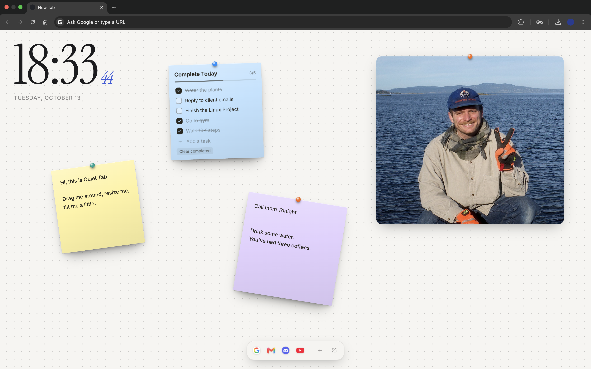
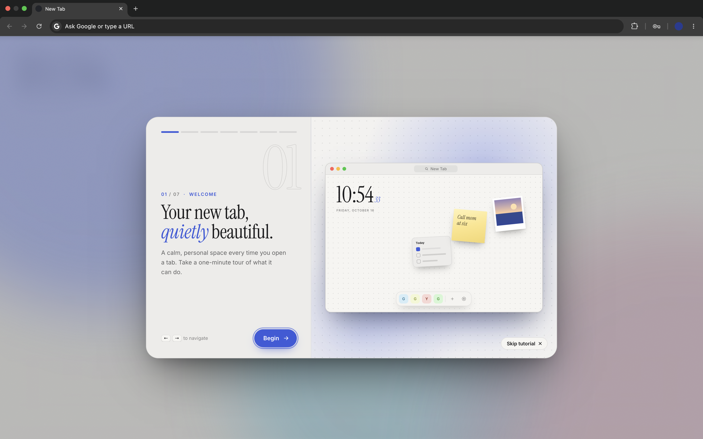

# Quiet Tab

A calm, minimal New Tab page for Chrome.

I wanted a new tab that didn't shout at me, so I made one: a big clock, a soft dotted background, and a small toolbar with the sites I actually use. If you want more, there's a pinboard for images, sticky notes and to-do lists. If you don't, everything can be switched off.

## What's inside

- **A clock that stays out of the way.** Set in Instrument Serif, with 12/24-hour, seconds, date and size options. You can turn it off entirely.
- **A tiny toolbar** for your shortcuts. Add one in seconds from the **+** menu. Put it at the bottom, top, left or right with automatic overflow scrolling on compact viewports.
- **Pinboard.** Drop, paste or upload images, add sticky notes and to-do lists. Drag, resize, rotate, and pin them in place. Double-click any handle to reset rotation or scale.
- **Smooth page load animations.** Watch your clock, toolbar, photos, sticky notes, and to-dos gracefully rise into position with organic stagger and physical drift when opening a new tab.
- **Dynamic scaling & multiline tasks.** Resize sticky notes and to-dos smoothly—fonts scale proportionally, and long tasks wrap cleanly onto multiple lines without clipping.
- **Fluid keyboard navigation.** Arrow through your task lists with ease: jump between title, tasks, and the add input using `ArrowUp`, `ArrowDown`, and `Enter`.
- **A canvas you can pan.** Drag empty space to move around, and double-click to come back.
- **Your look.** Light or dark mode, custom colors (with hex codes), dots, grid or plain backgrounds, or your own photo with dim and blur.
- **Multi-tab synchronization & safe backups.** Seamlessly syncs settings and shortcuts across open tabs on focus, and export everything to a single JSON backup.
- **Guided onboarding tour.** First run walks through the clock, shortcuts, creating items, the pinboard and settings; replay it anytime from Settings → Help.

## Onboarding

## Install

1. Download `quiet-tab-v1.2.zip` from the [Releases](../../releases) page and unzip it.
2. Open `chrome://extensions` and turn on **Developer mode** (top right).
3. Click **Load unpacked** and pick the `quiet-tab-v1.2` folder.
4. Open a new tab. That's it.

Needs Chrome 111 or newer. It should also work in Edge, Brave and Arc.

## Privacy

Nothing leaves your computer. There are no accounts, no analytics and no network requests. Fonts are bundled, and settings and images are stored locally in your browser. The only permissions are `storage`, `unlimitedStorage` (so photos fit) and `favicon` (to show site icons).

## Good to know

- Site icons come from Chrome's own cache, so a brand-new shortcut may show a placeholder until you've visited the site once.
- Uploaded images are resized when you add them to keep things light.
- Double-clicking the rotate or resize handles instantly resets them to their default orientation and size.